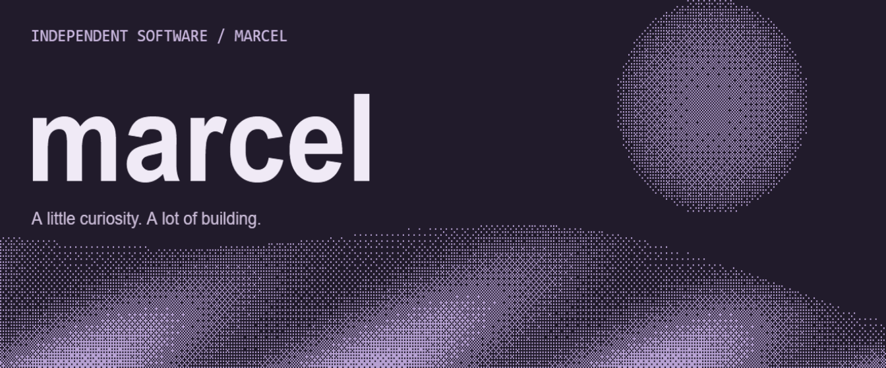

  

I build tools for **games, music, and the desktop.** 
Here’s a selection of what I’m working on.

## Main projects

<table>
<tr>
<td width="50%" valign="top">
01 / STRATEGY &amp; ANALYSIS
<h3><a href="https://github.com/tbhtho/RTS-Analytics">RTS Analytics</a></h3>

An Age of Empires IV companion for player scouting, an in-game overlay, and post-game analysis.

TypeScript · Desktop companion

<a href="https://github.com/tbhtho/RTS-Analytics">Explore project</a>
</td>
<td width="50%" valign="top">
02 / MUSIC &amp; DESKTOP
<h3><a href="https://github.com/tbhtho/Advanced-Music-Player">Advanced Music Player</a></h3>

A desktop player bringing Spotify and SoundCloud into one place.

TypeScript · Music player

<a href="https://github.com/tbhtho/Advanced-Music-Player">Explore project</a>
</td>
</tr>
</table>

### VALORANT MVM
**Private project** · Cinematic tools for creating scenes from VALORANT replays.

### VALORANT Blender
**Private project** · A VALORANT-to-Blender creative workflow.

### [Rosivrepyh](https://github.com/tbhtho/Rosivrepyh)
**Completed project** · An x64 UEFI and Intel VT-x hypervisor research project.

## Side projects & earlier work

[**mac-lan**](https://github.com/tbhtho/mac-lan) 
Control and switch between Windows and Mac over a local network.

[**FF-Sandbox**](https://github.com/tbhtho/FF-Sandbox) 
A trickshot sandbox with custom loadouts, practice tools, and replay editing.

[**Deadlock MVM**](https://github.com/tbhtho/deadlock-mvm) · Archived 
Cinematic camera paths and recording tools for Deadlock replays.

---

[All repositories](https://github.com/tbhtho?tab=repositories)
